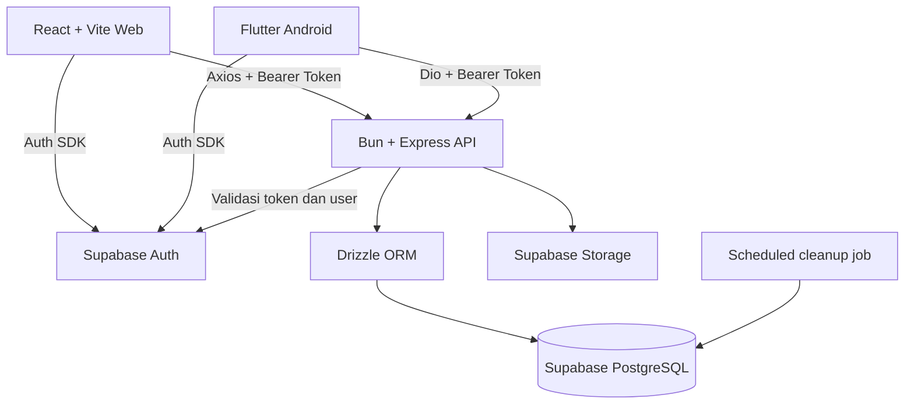
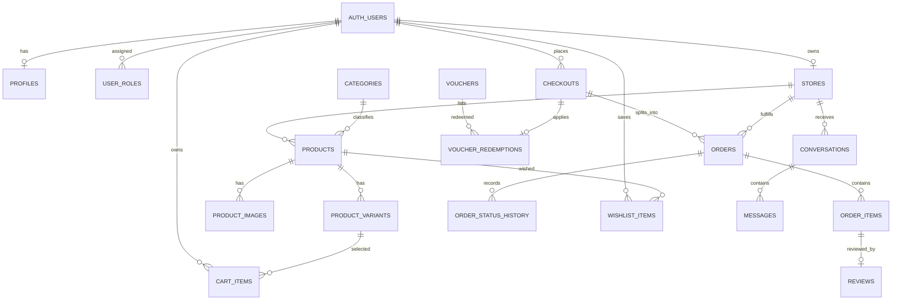

# SOUQNA — Rancangan MVP Marketplace

> **سُوقُنَا — Pasar Kita**  
> Dokumen acuan produk, alur bisnis, arsitektur, database, dan implementasi MVP.

| Informasi | Keterangan |
|---|---|
| Nama proyek | SOUQNA |
| Jenis produk | Marketplace kampus dan UMKM sekitar |
| Target platform | Web dan Android |
| Pengguna utama | Pembeli, merchant, dan admin |
| Status dokumen | Rancangan MVP yang telah dikunci berdasarkan keputusan proyek |
| Bahasa antarmuka awal | Bahasa Indonesia |
| Mata uang | Rupiah (IDR) |
| Zona waktu aplikasi | Asia/Jakarta |
| Tujuan | Proyek tugas akhir mata kuliah Web dan Android; implementasi kecil yang tetap memiliki fondasi teknis baik |

---

## 1. Ringkasan Produk

SOUQNA adalah marketplace sederhana untuk membantu mahasiswa, warga kampus, dan UMKM di sekitar kampus menjual serta membeli produk. Pengalaman belanja mengacu pada pola marketplace seperti Shopee, tetapi ruang lingkupnya dibatasi agar realistis untuk proyek kuliah.

Web dibuat menggunakan **React + Vite + React Router**, sedangkan aplikasi Android dibuat menggunakan **Flutter**. Keduanya menggunakan satu **Bun + Express API**, satu proyek **Supabase Auth**, dan satu database **Supabase PostgreSQL**. Web menggunakan **Axios** untuk memanggil API, Flutter menggunakan **Dio**, dan backend memakai **Drizzle ORM** untuk akses database. Runtime JS untuk `frontend/` dan `backend/` memakai **Bun** (bukan Node.js/`npm` langsung).

SOUQNA tidak memproses uang secara digital dan tidak menjadi payment gateway. Pembayaran dilakukan secara **COD (cash on delivery / bayar tunai saat serah terima)**. Sistem hanya mencatat status pembayaran berdasarkan konfirmasi merchant setelah uang tunai benar-benar diterima.

Pembeli boleh melihat katalog tanpa login. Login diperlukan untuk melakukan checkout, menyimpan wishlist, mengirim chat, menulis ulasan, dan menjadi merchant.

## 2. Tujuan dan Batasan MVP

### 2.1 Tujuan

1. Menyediakan katalog produk, kategori, pencarian, detail produk, variasi, dan stok.
2. Memungkinkan pengguna membuat pesanan dari produk beberapa merchant dalam satu checkout.
3. Memecah checkout multi-merchant menjadi pesanan terpisah untuk setiap toko.
4. Menyediakan pengelolaan toko, produk, variasi, stok, dan pesanan untuk merchant.
5. Mencatat status pesanan dan status pembayaran COD secara terpisah.
6. Menyediakan wishlist, chat teks, ulasan, voucher, dan panel admin sederhana.
7. Menjadikan web dan Android memakai backend dan database bisnis yang sama.

### 2.2 Tidak termasuk dalam MVP

- Payment gateway, virtual account, kartu, QRIS, dompet digital, atau pemrosesan pembayaran online.
- Pengelolaan kurir eksternal, pelacakan GPS langsung, atau optimasi rute pengiriman.
- Pengiriman nasional atau integrasi ekspedisi.
- Chat dengan gambar, video, lampiran, voice note, atau panggilan.
- Banyak toko untuk satu akun merchant.
- Variasi produk dengan konfigurasi stok lintas kombinasi yang kompleks di luar pilihan variasi sederhana.
- Rekomendasi produk berbasis AI, sistem iklan, flash sale, dan program loyalitas.
- Aplikasi iOS sebagai target wajib.
- Moderasi otomatis berbasis AI.

### 2.3 Prinsip MVP

- Sederhana untuk dikembangkan, diuji, dan didemonstrasikan.
- Backend menjadi sumber kebenaran untuk harga, stok, otorisasi, voucher, dan status pesanan.
- Semua perubahan penting divalidasi di server; validasi UI bukan satu-satunya pengaman.
- Web dan Android tidak mengakses tabel bisnis PostgreSQL secara langsung. Operasi bisnis melalui API yang sama.
- Fitur tambahan tidak boleh memperluas ruang lingkup sebelum alur utama selesai dan stabil.

## 3. Keputusan Produk yang Sudah Dikunci

| Topik | Keputusan |
|---|---|
| Pendaftaran | Terbuka untuk siapa saja; admin tidak perlu memasukkan email pengguna terlebih dahulu. |
| Login | Email/password dan Google Sign-In melalui Supabase Auth. |
| Login untuk browsing | Tidak wajib. |
| Login untuk transaksi | Wajib untuk checkout dan fitur personal. |
| Peran akun | Pengguna dapat menjadi pembeli dan merchant dengan akun yang sama. |
| Aktivasi merchant | Otomatis setelah formulir toko berhasil disimpan. Satu akun hanya memiliki satu toko. |
| Variasi produk | Didukung; harga dan stok dapat berbeda per variasi. |
| Keranjang | Dapat berisi produk dari banyak merchant. |
| Checkout multi-merchant | Satu proses checkout menghasilkan satu grup checkout dengan satu pesanan per toko. |
| Pembayaran | COD saja. Aplikasi tidak memproses transfer atau pembayaran digital. |
| Pencatatan lunas | Merchant menandai lunas setelah menerima uang tunai. |
| Pesanan selesai | Pembeli telah mengonfirmasi barang diterima **dan** merchant telah menandai pembayaran diterima. |
| Pemenuhan pesanan | Ambil sendiri atau diantar merchant. |
| Biaya pengantaran | Ditentukan merchant dan ditambahkan ke total pesanan COD. |
| Voucher | Dibuat dan dikelola oleh admin saja. |
| Chat | Teks saja, tanpa lampiran. Setiap pesan dihapus otomatis setelah berumur tujuh hari. Percakapan tetap ada. |
| Ulasan | Hanya dapat dibuat untuk item pesanan yang sudah selesai. |
| Wishlist | Tersimpan per akun. |
| Reset password | Admin memicu alur pemulihan email; pengguna membuat password baru melalui tautan pemulihan. Admin tidak melihat password pengguna. |
| Hapus pengguna | Admin dapat menghapus akun. Pesanan aktif diselesaikan atau ditangani terlebih dahulu. Riwayat transaksi selesai dipertahankan dengan identitas yang dianonimkan. |
| Pendaftaran ulang | Email yang sama boleh mendaftar lagi setelah akun dihapus; akun dan toko lama tidak dipulihkan. Tidak ada blacklist permanen. |
| Panel admin | Pengguna, kategori, moderasi produk, pesanan, dan voucher. Admin tidak menjadi pihak yang memproses pembayaran. |

## 4. Pengguna, Peran, dan Hak Akses

### 4.1 Pengunjung

Dapat:
- Melihat katalog, kategori, detail produk, toko, harga, stok yang tersedia, dan ulasan.
- Melakukan pencarian serta filter produk.

Tidak dapat:
- Checkout, menyimpan wishlist ke akun, mengirim chat, menulis ulasan, atau mengelola toko.

### 4.2 Pengguna terdaftar / Pembeli

Dapat melakukan seluruh aktivitas pengunjung, ditambah:
- Mengelola profil dan informasi kontak.
- Mengelola keranjang dan wishlist.
- Checkout produk dari satu atau beberapa toko.
- Melihat pesanan dan status masing-masing pesanan toko.
- Membatalkan pesanan selama merchant belum menerima pesanan.
- Mengonfirmasi barang sudah diterima.
- Menggunakan voucher yang valid.
- Mengirim chat teks ke merchant.
- Memberi ulasan untuk item pesanan yang selesai.
- Mengajukan diri menjadi merchant melalui pengaturan akun.

### 4.3 Merchant

Merchant adalah pengguna terdaftar yang telah memiliki satu toko aktif. Merchant tetap dapat berbelanja sebagai pembeli menggunakan akun yang sama.

Dapat:
- Membuat dan memperbarui informasi satu toko.
- Menambahkan, memperbarui, menyembunyikan, dan menghapus produk milik tokonya.
- Mengelola variasi, harga, stok, dan gambar produk.
- Melihat pesanan yang dialokasikan ke tokonya.
- Menerima atau menolak pesanan yang masih menunggu keputusan.
- Memperbarui status kesiapan/pengantaran.
- Menandai pembayaran COD sudah diterima setelah uang tunai benar-benar diterima.
- Mengatur apakah toko mendukung pengantaran dan menentukan biaya pengantaran.
- Membalas chat pembeli.

Tidak dapat:
- Mengubah harga atau stok produk milik toko lain.
- Membuat voucher marketplace.
- Mengubah status pembayaran tanpa tindakan terotorisasi.
- Menandai pesanan selesai hanya dengan satu tindakan; penyelesaian membutuhkan konfirmasi penerimaan pembeli dan pembayaran berstatus lunas.

### 4.4 Admin

Admin memiliki hak khusus yang ditetapkan melalui mekanisme backend/operasional yang aman, bukan melalui pilihan role saat registrasi.

Dapat:
- Melihat dan mengelola akun pengguna.
- Memicu pengiriman email pemulihan password.
- Menghapus akun setelah pengecekan pesanan aktif dan proses anonimisasi data yang diperlukan.
- Mengelola kategori.
- Menyembunyikan produk yang melanggar aturan atau tidak layak ditampilkan.
- Melihat dan membantu menangani pesanan bermasalah.
- Membuat, mengubah, mengaktifkan, menonaktifkan, dan memantau voucher.
- Melihat log tindakan administratif.

Admin tidak:
- Menyimpan atau melihat password pengguna dalam bentuk plaintext.
- Menggunakan pilihan role dari aplikasi klien sebagai dasar otorisasi.
- Menandai pembayaran COD lunas atas nama merchant tanpa proses penanganan yang tercatat.

## 5. Alur Utama Pengguna

### 5.1 Browsing dan pencarian

1. Pengunjung membuka halaman utama.
2. Sistem menampilkan kategori, produk aktif, produk terbaru, serta produk yang masih tersedia.
3. Pengunjung dapat mencari dengan kata kunci dan memfilter kategori/harga.
4. Pengunjung membuka detail produk dan memilih variasi.
5. Untuk wishlist, chat, dan checkout, sistem meminta pengguna login atau daftar.

### 5.2 Registrasi dan login

- Email/password dan Google Sign-In ditangani Supabase Auth.
- Setelah autentikasi berhasil, aplikasi mengambil token sesi dan mengirimkannya sebagai Bearer Token ke Express API.
- API memvalidasi token sebelum memproses data bisnis.
- Role admin tidak pernah dibuat oleh registrasi publik.
- Email confirmation dapat diaktifkan lewat konfigurasi Supabase. Untuk deployment publik, verifikasi email direkomendasikan; kebijakan akhir mengikuti konfigurasi lingkungan proyek.

### 5.3 Menjadi merchant

1. Pengguna login.
2. Pengguna membuka **Pengaturan → Jadi Merchant**.
3. Pengguna mengisi nama toko, deskripsi, logo/foto, lokasi pengambilan, pilihan pengantaran, dan biaya pengantaran bila tersedia.
4. Backend memvalidasi data dan memastikan akun belum memiliki toko.
5. Setelah berhasil, toko dibuat dan merchant dapat mengelola produk.
6. Satu akun tidak boleh membuat toko kedua. Permintaan kedua ditolak oleh backend dan dibatasi oleh unique constraint database.

### 5.4 Mengelola produk

1. Merchant membuat produk dengan nama, kategori, deskripsi, dan gambar.
2. Merchant membuat minimal satu variasi.
3. Setiap variasi memiliki pilihan/atribut, harga, dan stok tersendiri.
4. Produk dapat ditayangkan setelah lolos validasi serta memenuhi status publikasi yang ditentukan aplikasi.
5. Produk yang stok seluruh variasinya nol tetap dapat ditampilkan, tetapi harus diberi label habis dan tidak dapat dimasukkan ke checkout.

### 5.5 Keranjang dan checkout multi-merchant

1. Pembeli menambahkan satu atau beberapa variasi ke keranjang.
2. Keranjang dapat berisi item dari beberapa toko.
3. Saat checkout, backend mengambil ulang harga, status produk, variasi, stok, biaya pengantaran, dan voucher dari database. Nilai total dari frontend tidak dipercaya.
4. Pembeli memilih metode pemenuhan yang tersedia per toko: ambil sendiri atau diantar merchant.
5. Bila memilih pengantaran, pembeli memasukkan lokasi/ titik serah terima dan backend memasukkan biaya pengantaran toko.
6. Backend memvalidasi semua item dan stok dalam satu transaksi database.
7. Sistem membuat satu record `checkouts` dan satu record `orders` untuk setiap toko dalam checkout tersebut.
8. Setiap order memiliki status, biaya pengantaran, diskon teralokasi, total, dan status pembayaran sendiri.
9. Jika salah satu item tidak valid atau stok tidak cukup, seluruh checkout gagal secara atomik. Pembeli diberi informasi item yang perlu diperbaiki sebelum mengulangi checkout.
10. Setelah checkout berhasil, item yang di-checkout dihapus dari keranjang.

**Penting:** Jika satu toko menolak pesanan, pesanan dari toko lain tidak otomatis dibatalkan. Setiap pesanan merchant diproses secara independen.

### 5.6 Alur pesanan

Status pesanan yang disarankan:

- `pending_merchant_confirmation`: menunggu merchant menerima/menolak.
- `accepted`: merchant menerima pesanan.
- `ready_for_pickup`: produk siap diambil pembeli.
- `out_for_delivery`: merchant sedang mengantarkan produk.
- `received_by_buyer`: pembeli mengonfirmasi barang sudah diterima.
- `completed`: pembeli sudah mengonfirmasi penerimaan dan pembayaran sudah ditandai lunas.
- `rejected`: merchant menolak pesanan.
- `cancelled`: pembeli membatalkan sebelum merchant menerima pesanan.

Aturan transisi:
- Pembeli hanya boleh membatalkan order saat `pending_merchant_confirmation`.
- Merchant hanya boleh menerima/menolak order yang masih menunggu konfirmasi.
- Untuk pengambilan sendiri, merchant mengubah status menjadi `ready_for_pickup`.
- Untuk pengantaran, merchant mengubah status menjadi `out_for_delivery`.
- Pembeli dapat mengonfirmasi penerimaan setelah penyerahan barang.
- Merchant hanya menandai pembayaran lunas setelah benar-benar menerima uang tunai.
- Order berubah menjadi `completed` hanya jika `status = received_by_buyer` dan `payment_status = paid` telah terpenuhi. Jika salah satu terjadi lebih dulu, order menunggu kondisi lainnya.
- `rejected` dan `cancelled` adalah status akhir untuk alur biasa.
- Stok yang telah direservasi dikembalikan ketika order ditolak atau dibatalkan.

### 5.7 Status pembayaran COD

Status pembayaran disimpan terpisah dari status pesanan:

- `unpaid`: uang tunai belum dikonfirmasi diterima merchant.
- `paid`: merchant telah mengonfirmasi menerima uang tunai.

Metode pembayaran dalam MVP selalu `cod`. Tidak ada pemanggilan payment gateway atau pemindahan uang melalui aplikasi.

### 5.8 Chat dan retensi pesan

- Percakapan dibuat antara pembeli dan satu toko.
- Chat hanya mendukung teks, tanpa file atau lampiran.
- Pesan ditampilkan berdasarkan urutan waktu.
- Setiap pesan dihapus otomatis saat usianya mencapai tujuh hari.
- Penghapusan pesan tidak menghapus record percakapan. Thread dapat tetap ada walaupun riwayat pesan sudah kosong.
- Tugas terjadwal di backend/database secara berkala menghapus pesan yang lebih tua dari tujuh hari.
- Sistem tidak boleh bergantung pada aplikasi web atau Android yang sedang terbuka untuk menjalankan penghapusan.
- Penghapusan dari tabel aktif tidak selalu berarti salinan pada backup penyedia langsung hilang; masa retensi backup mengikuti konfigurasi layanan.

### 5.9 Ulasan dan wishlist

- Pengguna dapat membuat paling banyak satu ulasan untuk satu item pesanan yang telah selesai.
- Rating menggunakan skala 1–5. Teks ulasan dapat bersifat opsional tetapi dianjurkan.
- Ulasan harus terhubung ke item pesanan milik pengguna yang sedang login.
- Wishlist tersimpan di database per pengguna dan hanya dapat dibaca/diubah pemiliknya.
- Pengunjung tanpa login yang menekan wishlist akan diminta login.

### 5.10 Penghapusan pengguna

1. Admin memilih akun yang akan dihapus.
2. Backend memeriksa apakah pengguna masih memiliki pesanan aktif.
3. Jika masih ada, penghapusan final ditolak sampai pesanan aktif ditangani. Admin harus menyelesaikan atau membatalkan pesanan sesuai kondisi dan menyimpan jejak tindakannya.
4. Toko terkait dinonaktifkan dan produk tidak lagi ditampilkan kepada publik.
5. Hubungan akun dengan riwayat transaksi yang perlu dipertahankan dilepas atau dianonimkan. Informasi kontak/lokasi pribadi pada snapshot transaksi harus dihapus atau disamarkan.
6. Akun Auth dihapus melalui mekanisme admin Supabase di backend. Secret admin tidak dikirim ke aplikasi klien.
7. API menolak token yang tidak lagi memiliki profil aplikasi aktif, sehingga akun yang dihapus tidak bisa terus melakukan tindakan melalui token lama.
8. Pengguna dapat mendaftar kembali dengan alamat email yang sama, tetapi akun, toko, wishlist, dan sesi lama tidak dipulihkan.

## 6. Arsitektur Teknis

### 6.1 Komponen

| Komponen | Teknologi | Tanggung jawab |
|---|---|---|
| Web | React + Vite + React Router (Bun) | UI marketplace, panel merchant, panel admin sesuai izin |
| HTTP client web | Axios | Memanggil REST API, mengirim token, menangani error dan respons |
| Android | Flutter | UI Android marketplace, merchant, dan admin bila diaktifkan di mobile |
| HTTP client Android | Dio | Memanggil REST API yang sama |
| Auth SDK web | Supabase JS | Registrasi, login email/password, Google, session, password recovery |
| Auth SDK Android | Supabase Flutter | Registrasi, login email/password, Google, session, password recovery |
| Backend API | Bun + Express | Validasi request, otorisasi, aturan bisnis, checkout, status pesanan, chat, admin |
| Runtime JS | Bun | Runtime + package manager untuk `frontend/` dan `backend/` (`bun install`, `bun dev`, `bunx`) |
| ORM | Drizzle ORM | Query dan transaksi PostgreSQL dari backend |
| Database | Supabase PostgreSQL | Sumber data tunggal untuk seluruh data bisnis |
| Auth | Supabase Auth | Identitas, email/password, OAuth Google, token, pemulihan password |
| File | Supabase Storage | Foto produk, logo toko, dan avatar bila diperlukan |
| Scheduler | Scheduled job terkelola | Penghapusan pesan chat yang telah berusia tujuh hari |

### 6.2 Aliran sistem



### 6.3 Aturan arsitektur yang wajib

1. **Satu proyek Supabase** digunakan oleh web, Android, dan backend.
2. Operasi bisnis—produk, stok, keranjang, checkout, pesanan, voucher, ulasan, wishlist, chat, toko, dan admin—dilakukan melalui Express API.
3. Supabase Auth SDK boleh digunakan langsung di klien untuk autentikasi, OAuth, sesi, dan alur pemulihan password.
4. Setiap request API yang memerlukan login menyertakan `Authorization: Bearer <access_token>`.
5. Backend memvalidasi token; jangan mempercayai `user_id`, `role`, harga, total, diskon, status pembayaran, atau status pesanan yang hanya dikirim oleh klien.
6. `SUPABASE_SERVICE_ROLE_KEY`, kredensial database, OAuth client secret, dan secret lain hanya berada di lingkungan backend/secret manager.
7. Jangan menaruh secret server di variabel `VITE_*`, source React, aplikasi Flutter, repository, atau file konfigurasi yang dikirim ke pengguna.
8. Role admin tidak boleh diatur melalui request profil pengguna. Role admin diberikan melalui seed/migrasi/operasi backend terproteksi.
9. Gunakan transaksi database untuk operasi kritis: checkout multi-merchant, perubahan stok, penolakan/pembatalan order, penebusan voucher, dan penyelesaian order.
10. Seluruh validasi ownership dilakukan di backend, termasuk memastikan merchant hanya memodifikasi tokonya sendiri.

### 6.4 Autentikasi dan otorisasi

- **Autentikasi:** Supabase Auth membuktikan identitas dan menerbitkan access token.
- **Otorisasi:** Express API memeriksa identitas, keberadaan profil aktif, role admin, kepemilikan toko, kepemilikan order, dan hak atas setiap resource.
- **Peran:** pengguna biasa menjadi default. Status merchant ditentukan oleh keberadaan toko aktif yang dimiliki akun. Admin disimpan sebagai role terpisah yang tidak dapat diberikan melalui UI publik.
- **Google Sign-In:** konfigurasi OAuth harus disiapkan di Supabase dan Google Cloud untuk web dan Android, termasuk callback/redirect URL yang sesuai.
- **Password recovery:** tautan pemulihan diarahkan ke halaman web atau deep link Android yang valid; pengguna memasukkan password baru melalui alur resmi Supabase.
- **Email confirmation:** dapat diatur melalui dashboard Supabase. Untuk deployment publik, sebaiknya diaktifkan; lingkungan demonstrasi dapat menggunakan pengaturan yang sesuai kebutuhan kelas.

### 6.5 Database access dan keamanan

- Drizzle terhubung ke PostgreSQL menggunakan `DATABASE_URL` backend.
- Gunakan koneksi/pooling yang sesuai dengan lingkungan deployment. Jika menggunakan Supabase transaction pooler dengan `postgres.js`, periksa kebutuhan opsi driver seperti `prepare: false` sesuai panduan driver.
- Gunakan akun database dengan hak minimum yang cukup untuk aplikasi. Jangan menyalin service role secret ke klien.
- Karena akses bisnis melewati API, backend tetap wajib memeriksa ownership dan role setiap request. Jika ada akses tabel melalui Supabase Data API di masa depan, aktifkan dan uji RLS untuk tabel yang diekspos.
- Terapkan rate limit pada autentikasi yang melewati aplikasi, chat, pencarian, checkout, voucher, dan endpoint administratif.
- Simpan tindakan sensitif admin dalam audit log.

## 7. Struktur Repository Aktual (Wajib Diikuti)

Struktur ini menyesuaikan folder yang sudah ada di repo, bukan pola `apps/` generik.
Satu monorepo untuk web, API, database, dokumentasi, dan Flutter agar kontrak API dan skema berkembang bersama.

```text
SOUQNA/
├── frontend/                   # React + Vite + Axios + React Router (Bun)
├── backend/                    # Bun + Express + Drizzle ORM
├── db/                         # Skema, migrasi, dan seed Drizzle (dipakai backend)
├── flutter/                    # Flutter Android + Dio
├── docs/
│   ├── proposal/               # Dokumen proposal yang sudah ada
│   ├── API_CONTRACT.md         # Opsional, dipisah saat API berkembang
│   └── ERD.md                  # Diagram relasi database
├── SOUQNA_MVP.md               # Dokumen acuan ini (root, sesuai kondisi repo saat ini)
├── .gitignore
└── README.md
```

Pemetaan ke dokumen lama:
- `apps/web/` -> `frontend/`
- `apps/api/` -> `backend/` (kode) + `db/` (skema/migrasi/seed)
- `apps/mobile/` -> `flutter/`
- `infra/scripts/` -> `backend/src/scripts/` atau `db/seed/` (jangan buat folder `infra/` baru kecuali perlu script deployment terpisah).

### 7.1 Struktur `frontend/` (React + Vite + React Router)

Web memakai **React Router** agar navigasi rapih: definisi route terpusat di `src/routes/`,
layout dipisah di `src/layouts/`, dan halaman di `src/pages/` sesuai §11.1.
Logic per-fitur (hooks + pemanggil API) tetap di `src/features/`.

```text
frontend/src/
├── app/                        # Provider aplikasi (AuthProvider, QueryClient, dsb.)
│   ├── App.tsx                 # <RouterProvider router={router} />
│   └── providers.tsx
├── routes/                     # Wajib: pusat React Router
│   ├── router.tsx              # createBrowserRouter([...])
│   ├── public.tsx              # /, /search, /products/:productId, /stores/:storeId, /login, /register
│   ├── protected.tsx           # /cart, /checkout, /orders, /wishlist, /chat, /me, /become-merchant (RequireAuth)
│   ├── merchant.tsx            # /merchant/* (RequireMerchant)
│   ├── admin.tsx               # /admin/* (RequireAdmin)
│   └── guards.tsx              # RequireAuth, RequireMerchant, RequireAdmin
├── layouts/
│   ├── PublicLayout.tsx        # Navbar publik + Outlet
│   ├── AuthLayout.tsx          # Layout login/register/reset-password
│   ├── AccountLayout.tsx       # Layout profil, orders, wishlist, chat pengguna
│   ├── MerchantLayout.tsx      # Sidebar merchant + Outlet
│   └── AdminLayout.tsx         # Sidebar admin + Outlet
├── pages/
│   ├── home/HomePage.tsx
│   ├── catalog/SearchPage.tsx
│   ├── catalog/CategoryListPage.tsx
│   ├── catalog/ProductDetailPage.tsx
│   ├── catalog/StoreDetailPage.tsx
│   ├── auth/LoginPage.tsx
│   ├── auth/RegisterPage.tsx
│   ├── auth/ResetPasswordPage.tsx
│   ├── account/ProfilePage.tsx
│   ├── cart/CartPage.tsx
│   ├── checkout/CheckoutPage.tsx
│   ├── checkout/CheckoutSummaryPage.tsx
│   ├── orders/OrderListPage.tsx
│   ├── orders/OrderDetailPage.tsx
│   ├── wishlist/WishlistPage.tsx
│   ├── chat/ChatPage.tsx
│   ├── merchant/MerchantDashboardPage.tsx
│   ├── merchant/StoreProfilePage.tsx
│   ├── merchant/ProductListPage.tsx
│   ├── merchant/ProductFormPage.tsx
│   ├── merchant/MerchantOrderListPage.tsx
│   ├── merchant/MerchantOrderDetailPage.tsx
│   ├── admin/AdminDashboardPage.tsx
│   ├── admin/AdminUsersPage.tsx
│   ├── admin/AdminCategoriesPage.tsx
│   ├── admin/AdminProductsPage.tsx
│   ├── admin/AdminOrdersPage.tsx
│   ├── admin/AdminVouchersPage.tsx
│   └── admin/AdminAuditLogsPage.tsx
├── features/
│   ├── auth/
│   ├── catalog/
│   ├── cart/
│   ├── checkout/
│   ├── orders/
│   ├── merchant/
│   ├── chat/
│   ├── reviews/
│   ├── wishlist/
│   └── admin/
├── components/                 # Komponen UI reusable
├── lib/
│   ├── api-client.ts           # Axios instance dan bearer token
│   └── supabase.ts             # Auth client
├── hooks/
├── utils/
├── types/
└── main.tsx
```

Aturan React Router:
1. Jangan definisikan `<Route>` tersebar di tiap page; semua route didaftarkan di `routes/router.tsx`.
2. `pages/` hanya berisi komponen halaman, tidak berisi logika routing.
3. Guard (`RequireAuth`, dst.) membaca sesi Supabase + profil `/me` dari API, bukan role dari localStorage.
4. Path mengikuti §11.1 agar konsisten dengan Flutter deep link.

### 7.2 Struktur `backend/` (Bun + Express + Drizzle)

Kode API hidup di `backend/src/`. Skema/migrasi/seed hidup di top-level `db/` (lihat §7.4)
dan diimpor backend, supaya satu sumber kebenaran dan tidak duplikat antara `backend/` dan `db/`.

```text
backend/src/
├── app.ts
├── server.ts
├── config/
├── middleware/
│   ├── authenticate.ts
│   ├── authorize.ts
│   ├── validate.ts
│   └── error-handler.ts
├── modules/
│   ├── profiles/
│   ├── catalog/
│   ├── stores/
│   ├── products/
│   ├── cart/
│   ├── checkout/
│   ├── orders/
│   ├── vouchers/
│   ├── wishlist/
│   ├── reviews/
│   ├── chat/
│   └── admin/
├── jobs/
│   └── purge-expired-messages.ts
├── scripts/                    # Pengganti infra/scripts: bootstrap admin, dsb.
└── utils/
```

`backend/` tidak boleh berisi salinan skema sendiri. Import dari `../../db/schema/`, dll.

### 7.3 Struktur `flutter/` (Android)

```text
flutter/lib/
├── app/
├── core/
│   ├── api/                    # Dio client dan interceptor
│   ├── auth/                   # Supabase Auth
│   ├── config/
│   └── errors/
├── features/
│   ├── catalog/
│   ├── auth/
│   ├── cart/
│   ├── checkout/
│   ├── orders/
│   ├── merchant/
│   ├── chat/
│   ├── reviews/
│   ├── wishlist/
│   └── profile/
├── shared/
└── main.dart
```

### 7.4 Struktur `db/` (Drizzle — sumber kebenaran skema)

`db/` saat ini masih kosong. Isi minimal yang wajib dibuat:

```text
db/
├── schema/                     # Definisi Drizzle per tabel §8 (profiles, stores, products, ...)
│   ├── profiles.ts
│   ├── stores.ts
│   ├── products.ts
│   ├── cart.ts
│   ├── checkout.ts
│   ├── orders.ts
│   ├── vouchers.ts
│   ├── chat.ts
│   ├── reviews.ts
│   └── admin.ts
├── migrations/                 # Hasil drizzle-kit generate (jangan edit manual)
├── seed/
│   ├── categories.seed.ts
│   └── demo.seed.ts
├── drizzle.config.ts           # Menunjuk ke DATABASE_URL backend
└── index.ts                    # Ekspor db + schema untuk dipakai backend/src/
```

Struktur ini adalah rekomendasi awal, bukan kewajiban membuat semua folder sebelum fitur terkait dikerjakan.
Pengecualian: `frontend/src/routes/`, `frontend/src/layouts/`, `frontend/src/pages/`, `backend/src/modules/`,
dan `db/schema/` sebaiknya dibuat di Tahap 1 agar fondasi routing dan migrasi tidak berubah-ubah.

## 8. Model Data dan Skema Database

### 8.1 Konvensi umum

- Primary key bisnis menggunakan UUID.
- Seluruh waktu disimpan sebagai `timestamptz` dan ditampilkan dengan zona waktu `Asia/Jakarta`.
- Harga, subtotal, diskon, dan biaya menggunakan `numeric(12,2)`; jangan memakai floating point untuk perhitungan uang.
- Kuantitas stok berupa integer non-negatif.
- Gunakan `created_at` dan `updated_at` pada tabel yang perlu audit waktu.
- Status yang memiliki daftar terbatas menggunakan PostgreSQL enum atau constraint yang jelas.
- Data snapshot pada order item menyimpan nama produk, pilihan variasi, dan harga saat transaksi agar riwayat tidak berubah ketika katalog berubah.

### 8.2 Tabel inti

#### `profiles`

Profil aplikasi yang berhubungan dengan `auth.users`.

| Kolom | Keterangan |
|---|---|
| `id` | UUID; sama dengan ID user Supabase Auth |
| `full_name` | Nama tampilan |
| `phone` | Kontak pengguna, bila disediakan |
| `avatar_url` | URL avatar opsional |
| `default_location` | Lokasi umum pengguna opsional |
| `created_at`, `updated_at` | Waktu pembuatan/perubahan |

Data autentikasi seperti password tidak disimpan dalam tabel ini.

#### `user_roles`

| Kolom | Keterangan |
|---|---|
| `user_id` | ID profil/auth user |
| `role` | Minimal `admin`; user normal tidak bisa menambah role sendiri |
| `created_at` | Waktu pemberian role |

Pengguna biasa dapat dianggap sebagai pembeli tanpa row role khusus. Status merchant berasal dari toko yang dimiliki akun. Jika menggunakan role `customer`, jangan jadikan role tersebut eksklusif karena merchant tetap bisa menjadi pembeli.

#### `categories`

- `id`
- `name`
- `slug` (unik)
- `description` (opsional)
- `is_active`
- `created_at`, `updated_at`

Kategori hanya dapat dibuat/diubah oleh admin.

#### `stores`

| Kolom | Keterangan |
|---|---|
| `id` | UUID toko |
| `owner_id` | ID pemilik; unik agar satu akun hanya punya satu toko |
| `name`, `slug` | Nama publik dan slug unik |
| `description` | Deskripsi toko |
| `logo_url` | Logo/foto toko opsional |
| `pickup_location` | Lokasi pengambilan |
| `delivery_available` | Apakah toko menerima pengantaran |
| `delivery_fee` | Biaya tetap per pesanan pengantaran yang ditentukan merchant |
| `status` | `active`, `inactive`, atau `suspended` |
| `created_at`, `updated_at` | Timestamp |

Saat toko dinonaktifkan, produk tidak ditawarkan untuk checkout baru. Toko dengan pesanan aktif harus ditangani sebelum penghapusan akun pemilik.

#### `products`

- `id`
- `store_id`
- `category_id`
- `name`
- `slug`
- `description`
- `status`: `draft`, `published`, `hidden`, `suspended`
- `created_at`, `updated_at`

Harga dan stok jangan dijadikan sumber kebenaran utama pada tabel `products`; keduanya ada pada variasi.

#### `product_images`

- `id`
- `product_id`
- `storage_path` atau `image_url`
- `sort_order`
- `created_at`

File disimpan di Supabase Storage, sedangkan database menyimpan path atau metadata yang diperlukan. Backend memeriksa pemilik produk sebelum menerima permintaan unggah/perubahan gambar.

#### `product_variants`

- `id`
- `product_id`
- `sku` (opsional; unik jika digunakan)
- `label` atau `options` (contoh: `{"ukuran":"M","warna":"Hitam"}`)
- `price`
- `stock_quantity`
- `is_active`
- `created_at`, `updated_at`

Setiap variasi memiliki harga dan stok sendiri. Backend wajib memastikan `price >= 0` dan `stock_quantity >= 0`.

#### `cart_items`

- `id`
- `user_id`
- `product_variant_id`
- `quantity`
- `created_at`, `updated_at`

Tambahkan unique constraint pada pasangan (`user_id`, `product_variant_id`) agar satu variasi tidak menggandakan baris keranjang.

#### `checkouts`

Mewakili satu proses checkout oleh satu pembeli.

- `id`
- `buyer_id` (dapat menjadi null saat akun dihapus/anonymization)
- `checkout_code` (unik, dapat ditampilkan ke pengguna)
- `subtotal`
- `discount_total`
- `grand_total`
- `created_at`

Satu checkout dapat memiliki beberapa `orders`, masing-masing untuk toko berbeda.

#### `orders`

Satu record pesanan untuk satu toko di dalam sebuah checkout.

| Kolom | Keterangan |
|---|---|
| `id` | UUID pesanan |
| `checkout_id` | Grup checkout induk |
| `store_id` | Toko penanggung jawab pesanan |
| `buyer_id` | Pemilik pesanan; dapat menjadi null setelah anonimisasi |
| `status` | Status alur pesanan |
| `payment_method` | Selalu `cod` untuk MVP |
| `payment_status` | `unpaid` atau `paid` |
| `delivery_method` | `pickup` atau `merchant_delivery` |
| `delivery_fee` | Snapshot biaya pengantaran untuk order ini |
| `subtotal` | Total item sebelum diskon/biaya |
| `discount_amount` | Diskon yang dialokasikan untuk order ini |
| `grand_total` | Total yang perlu dibayar secara COD |
| `buyer_name_snapshot` | Snapshot nama untuk kebutuhan transaksi; harus dianonimkan saat penghapusan akun |
| `buyer_contact_snapshot` | Kontak transaksi; dihapus/disamarkan sesuai kebijakan penghapusan |
| `handover_location_snapshot` | Lokasi serah terima bila relevan; dihapus/disamarkan saat anonimisasi |
| `buyer_note` | Catatan opsional pembeli |
| `created_at`, `updated_at` | Timestamp |

Constraint yang disarankan: unique (`checkout_id`, `store_id`) sehingga hanya satu pesanan per toko pada satu checkout.

#### `order_items`

- `id`
- `order_id`
- `product_id` (nullable jika katalog dihapus)
- `product_variant_id` (nullable jika variasi dihapus)
- `product_name_snapshot`
- `variant_options_snapshot`
- `unit_price_snapshot`
- `quantity`
- `line_total`
- `created_at`

Riwayat order item harus tetap dapat dibaca jika produk kemudian disembunyikan atau dihapus dari katalog. Gunakan snapshot dan relasi yang tidak menghapus riwayat secara tidak sengaja.

#### `order_status_history`

- `id`
- `order_id`
- `from_status`
- `to_status`
- `changed_by` (dapat null/anonymized)
- `note` (opsional)
- `created_at`

Setiap perubahan status penting dicatat. Status tidak boleh diubah dengan mengirim nilai sewenang-wenang dari klien.

#### `vouchers`

- `id`
- `code` (unik, uppercase setelah normalisasi)
- `description`
- `discount_type`: `percentage` atau `fixed_amount`
- `discount_value`
- `minimum_subtotal`
- `maximum_discount` (opsional untuk persentase)
- `starts_at`, `ends_at`
- `usage_limit` (opsional)
- `used_count`
- `is_active`
- `created_by` (admin)
- `created_at`, `updated_at`

Voucher dibuat dan dikelola hanya melalui endpoint admin.

#### `voucher_redemptions`

- `id`
- `voucher_id`
- `checkout_id`
- `user_id` (dapat null setelah anonimisasi)
- `discount_amount`
- `created_at`

Tambahkan unique constraint pada `checkout_id` untuk menerapkan maksimum satu voucher per checkout pada MVP.

#### `wishlist_items`

- `id`
- `user_id`
- `product_id`
- `created_at`

Tambahkan unique constraint (`user_id`, `product_id`). Produk tersembunyi tidak ditawarkan dalam wishlist publik; jika produk tidak aktif, tampilkan bahwa produk tidak tersedia atau hilangkan dari daftar sesuai UX.

#### `conversations`

- `id`
- `buyer_id`
- `store_id`
- `created_at`, `updated_at`

Percakapan antara satu pembeli dengan satu toko. Untuk menghindari thread duplikat, terapkan strategi unique untuk pasangan pembeli/toko yang masih valid.

#### `messages`

- `id`
- `conversation_id`
- `sender_id`
- `body` (teks, dibatasi panjang maksimal yang ditentukan API, misalnya 2.000 karakter)
- `created_at`

Job terjadwal menghapus row dengan `created_at <= now() - interval '7 days'`. Jangan menghapus `conversations` hanya karena seluruh pesannya terhapus.

#### `reviews`

- `id`
- `order_item_id` (unik agar satu ulasan per item pesanan)
- `product_id`
- `buyer_id`
- `rating` (1–5)
- `review_text` (opsional)
- `display_name_snapshot` (opsional, untuk tampilan ulasan)
- `created_at`, `updated_at`

Backend harus memverifikasi pesanan terkait sudah `completed` dan item tersebut milik pembeli yang sedang login. Jika pengguna dihapus, identitas ulasan dianonimkan; isi ulasan dapat dipertahankan sesuai kebijakan moderasi.

#### `admin_audit_logs`

- `id`
- `admin_user_id`
- `action`
- `target_type`
- `target_id`
- `metadata` (JSON tanpa menyimpan password/token/secret)
- `created_at`

Gunakan untuk tindakan sensitif seperti penghapusan akun, moderasi produk, perubahan voucher, dan perubahan kategori.

### 8.3 Relasi utama



Diagram ini menunjukkan relasi konseptual; nama tabel/constraint final harus sesuai dengan implementasi Drizzle migration.

## 9. Aturan Bisnis yang Wajib Ditegakkan di Backend

### 9.1 Harga dan stok

- Harga yang dihitung berasal dari database, bukan dari request frontend.
- Stok tidak boleh negatif.
- Checkout memvalidasi seluruh variasi dan jumlah sebelum membuat order.
- Gunakan transaksi database untuk membuat checkout, order, order item, penebusan voucher, pengurangan/reservasi stok, dan pembersihan keranjang.
- Strategi MVP: reservasi/pengurangan stok dilakukan saat checkout berhasil. Stok dikembalikan ketika pesanan ditolak atau dibatalkan. Semua pengurangan/pengembalian stok harus atomik agar dua checkout bersamaan tidak membuat stok negatif.
- Jika satu toko menolak order, stok untuk item order toko tersebut dikembalikan; order toko lainnya tetap berjalan.
- Jika transaksi checkout gagal, tidak boleh ada order setengah jadi atau stok yang terpotong sebagian.

### 9.2 Harga dan total order

Rumus dasar per order toko:

```text
item_subtotal = SUM(unit_price_snapshot * quantity)
order_total = item_subtotal - allocated_discount + delivery_fee
```

- `delivery_fee = 0` untuk pengambilan sendiri.
- `delivery_fee` mengikuti konfigurasi biaya pengantaran toko saat checkout, lalu disimpan sebagai snapshot agar perubahan konfigurasi toko tidak mengubah pesanan yang sudah dibuat.
- Total COD adalah `order_total`.
- Nilai voucher dialokasikan secara konsisten ke order toko, misalnya proporsional terhadap subtotal item yang memenuhi syarat, supaya jumlah semua order tetap sama dengan total checkout.
- Perhitungan pembulatan harus konsisten dalam Rupiah dan diverifikasi di backend.

### 9.3 Voucher

- Kode voucher tidak peka huruf besar/kecil setelah dinormalisasi.
- Validasi status aktif, masa berlaku, minimum subtotal, batas penggunaan, dan batas diskon dilakukan di backend.
- MVP hanya mengizinkan satu voucher per checkout dan tidak menggabungkan voucher.
- Pengguna tidak dapat membuat voucher sendiri.
- Penggunaan voucher dan kenaikan hitungan penggunaan dilakukan dalam transaksi untuk menghindari penggunaan berlebih saat request bersamaan.

### 9.4 Otorisasi merchant

- Produk, variasi, stok, gambar, dan pesanan hanya dapat dimutasi oleh pemilik toko yang sesuai, kecuali tindakan administratif yang terotorisasi.
- ID toko dari frontend tidak cukup sebagai bukti kepemilikan; backend mencocokkan dengan user yang terautentikasi.
- Merchant tidak dapat menandai pembayaran lunas sebelum uang COD diterima.
- Merchant tidak dapat mengubah order milik toko lain.

### 9.5 Hapus akun dan anonimisasi

- Jangan menghapus tabel order/order item yang dibutuhkan untuk mempertahankan riwayat transaksi selesai.
- Hindari `ON DELETE CASCADE` dari akun ke riwayat transaksi.
- Sebelum Auth user dihapus, proses dependensi akun: tangani pesanan aktif, nonaktifkan toko/produk, lepaskan hubungan identitas, dan anonimisasi snapshot PII yang harus disimpan.
- Pastikan API menolak akun yang sudah tidak memiliki profil aktif walaupun access token lama belum kedaluwarsa.
- Tidak ada tabel blacklist email. Akun baru dengan email lama adalah identitas baru tanpa hubungan otomatis ke data toko/akun lama.

## 10. Kontrak Endpoint API

Prefix API: `/api/v1`. Semua endpoint bisnis menggunakan JSON kecuali upload file. Daftar berikut adalah kontrak awal; detail request/response dapat dipindahkan ke OpenAPI setelah implementasi dimulai.

### 10.1 Health dan profil

| Method | Endpoint | Akses | Keterangan |
|---|---|---|---|
| `GET` | `/health` | Publik | Pemeriksaan kesehatan API |
| `GET` | `/me` | Login | Profil dan status akun saat ini |
| `PATCH` | `/me` | Login | Memperbarui nama, nomor kontak, avatar, lokasi default |
| `POST` | `/me/delete-request` | Login | Mengirim permintaan hapus akun sendiri (opsional untuk UX) |

### 10.2 Katalog dan toko

| Method | Endpoint | Akses | Keterangan |
|---|---|---|---|
| `GET` | `/categories` | Publik | Daftar kategori aktif |
| `GET` | `/products` | Publik | Pencarian, filter kategori/harga, sorting, pagination |
| `GET` | `/products/:productId` | Publik | Detail produk dan variasi |
| `GET` | `/stores/:storeId` | Publik | Informasi toko aktif |
| `GET` | `/stores/:storeId/products` | Publik | Daftar produk toko |

Parameter pencarian yang disarankan: `q`, `categoryId`, `storeId`, `minPrice`, `maxPrice`, `sort`, `page`, `limit`. API membatasi nilai `limit` maksimum.

### 10.3 Merchant dan produk

| Method | Endpoint | Akses | Keterangan |
|---|---|---|---|
| `POST` | `/merchant/store` | Login, belum memiliki toko | Aktivasi merchant dan membuat toko |
| `GET` | `/merchant/store` | Merchant | Detail toko sendiri |
| `PATCH` | `/merchant/store` | Merchant | Memperbarui detail toko dan biaya pengantaran |
| `GET` | `/merchant/products` | Merchant | Daftar produk toko sendiri |
| `POST` | `/merchant/products` | Merchant | Membuat produk |
| `GET` | `/merchant/products/:productId` | Merchant pemilik | Detail produk milik sendiri |
| `PATCH` | `/merchant/products/:productId` | Merchant pemilik | Memperbarui produk |
| `DELETE` | `/merchant/products/:productId` | Merchant pemilik | Mengarsipkan/menyembunyikan produk dengan aman |
| `POST` | `/merchant/products/:productId/variants` | Merchant pemilik | Menambahkan variasi |
| `PATCH` | `/merchant/variants/:variantId` | Merchant pemilik | Mengubah harga, stok, opsi, atau status variasi |
| `DELETE` | `/merchant/variants/:variantId` | Merchant pemilik | Menonaktifkan variasi; tidak menghapus snapshot transaksi |
| `POST` | `/uploads/sign` | Login + hak atas target | Membuat izin upload terbatas untuk gambar |

### 10.4 Keranjang dan checkout

| Method | Endpoint | Akses | Keterangan |
|---|---|---|---|
| `GET` | `/cart` | Login | Melihat isi keranjang |
| `POST` | `/cart/items` | Login | Menambahkan variasi dan kuantitas |
| `PATCH` | `/cart/items/:itemId` | Login, pemilik item | Mengubah kuantitas |
| `DELETE` | `/cart/items/:itemId` | Login, pemilik item | Menghapus item keranjang |
| `POST` | `/checkout/validate` | Login | Memvalidasi stok, metode serah terima, dan voucher sebelum checkout |
| `POST` | `/checkout` | Login | Membuat satu checkout dan memecah pesanan per merchant |
| `GET` | `/checkouts/:checkoutId` | Pembeli pemilik | Ringkasan checkout dan daftar sub-order |

Request checkout mengandung referensi variasi/kuantitas, pilihan pemenuhan per toko, lokasi serah terima bila diantar, dan kode voucher opsional. Harga, diskon, serta total dihitung backend.

### 10.5 Pesanan pembeli dan merchant

| Method | Endpoint | Akses | Keterangan |
|---|---|---|---|
| `GET` | `/orders` | Login | Pesanan milik pembeli; merchant juga dapat memakai endpoint khusus merchant |
| `GET` | `/orders/:orderId` | Pembeli pemilik atau merchant toko terkait, atau admin | Detail pesanan |
| `POST` | `/orders/:orderId/cancel` | Pembeli pemilik | Batal selama order menunggu konfirmasi merchant |
| `POST` | `/orders/:orderId/confirm-received` | Pembeli pemilik | Mengonfirmasi barang diterima |
| `GET` | `/merchant/orders` | Merchant | Pesanan untuk tokonya |
| `POST` | `/merchant/orders/:orderId/accept` | Merchant toko terkait | Menerima pesanan |
| `POST` | `/merchant/orders/:orderId/reject` | Merchant toko terkait | Menolak pesanan dan mengembalikan stok |
| `POST` | `/merchant/orders/:orderId/ready-for-pickup` | Merchant toko terkait | Pesanan siap diambil |
| `POST` | `/merchant/orders/:orderId/out-for-delivery` | Merchant toko terkait | Pesanan sedang diantar |
| `POST` | `/merchant/orders/:orderId/mark-paid` | Merchant toko terkait | Menandai COD sudah diterima |

Setiap endpoint perubahan status memeriksa status awal yang sah, pelaku, kepemilikan, dan prasyarat bisnis. Jangan sediakan endpoint generik yang membolehkan klien mengirim status apa pun.

### 10.6 Wishlist, ulasan, dan chat

| Method | Endpoint | Akses | Keterangan |
|---|---|---|---|
| `GET` | `/wishlist` | Login | Wishlist pengguna |
| `POST` | `/wishlist/:productId` | Login | Menambah produk ke wishlist |
| `DELETE` | `/wishlist/:productId` | Login | Menghapus produk dari wishlist |
| `GET` | `/products/:productId/reviews` | Publik | Ulasan produk |
| `POST` | `/order-items/:orderItemId/review` | Pembeli pemilik, order selesai | Membuat ulasan yang valid |
| `GET` | `/conversations` | Login sebagai peserta | Daftar thread yang dapat diakses pengguna |
| `POST` | `/conversations` | Login | Membuat/mendapatkan thread dengan toko |
| `GET` | `/conversations/:conversationId/messages` | Peserta thread | Membaca pesan yang belum kedaluwarsa |
| `POST` | `/conversations/:conversationId/messages` | Peserta thread | Mengirim pesan teks |

### 10.7 Admin

| Method | Endpoint | Akses | Keterangan |
|---|---|---|---|
| `GET` | `/admin/users` | Admin | Pencarian dan daftar pengguna |
| `POST` | `/admin/users/:userId/send-password-recovery` | Admin | Memicu alur pemulihan email |
| `DELETE` | `/admin/users/:userId` | Admin | Memeriksa order aktif, menangani anonimisasi, dan menghapus akun |
| `POST` | `/admin/categories` | Admin | Membuat kategori |
| `PATCH` | `/admin/categories/:categoryId` | Admin | Mengubah kategori |
| `DELETE` | `/admin/categories/:categoryId` | Admin | Menonaktifkan/menghapus kategori dengan menjaga data produk historis |
| `GET` | `/admin/products` | Admin | Melihat dan memoderasi katalog |
| `POST` | `/admin/products/:productId/hide` | Admin | Menyembunyikan produk |
| `POST` | `/admin/products/:productId/publish` | Admin | Memublikasikan produk jika layak |
| `GET` | `/admin/orders` | Admin | Melihat pesanan untuk dukungan/penanganan masalah |
| `GET` | `/admin/vouchers` | Admin | Daftar voucher |
| `POST` | `/admin/vouchers` | Admin | Membuat voucher |
| `PATCH` | `/admin/vouchers/:voucherId` | Admin | Mengubah atau menonaktifkan voucher |
| `GET` | `/admin/audit-logs` | Admin | Melihat jejak tindakan administratif |

Semua endpoint `/admin/*` harus menggunakan middleware role admin di backend. Menyembunyikan tombol admin di frontend bukanlah pengamanan yang cukup.

## 11. Kebutuhan Halaman dan Navigasi

### 11.1 Web

**Publik:**
- Beranda
- Hasil pencarian
- Daftar kategori
- Detail produk
- Detail toko
- Login/registrasi
- Reset password

**Pengguna:**
- Profil dan pengaturan
- Keranjang
- Checkout
- Ringkasan checkout multi-merchant
- Daftar/detail pesanan
- Wishlist
- Chat
- Ulasan produk
- Formulir “Jadi Merchant”

**Merchant:**
- Dashboard toko ringkas
- Kelola profil toko
- Daftar produk
- Form tambah/edit produk
- Kelola variasi, harga, stok, dan gambar
- Daftar/detail pesanan
- Inbox chat

**Admin:**
- Dashboard statistik sederhana
- Pengguna
- Kategori
- Moderasi produk
- Pesanan
- Voucher
- Audit log

### 11.2 Android

Fitur inti web dan Android harus menggunakan API yang sama. Navigasi bawah yang disarankan:
- Beranda
- Kategori/Pencarian
- Keranjang
- Pesanan
- Akun

Fitur merchant ditampilkan dari menu akun apabila pengguna telah memiliki toko. Panel admin pada Android bersifat opsional; prioritas panel admin adalah web agar lebih mudah digunakan untuk administrasi.

## 12. Kebutuhan Nonfungsional

### 12.1 UX dan kompatibilitas

- Antarmuka berbahasa Indonesia.
- Web responsif untuk desktop dan layar ponsel.
- Android mendukung ukuran layar umum.
- Semua halaman penting memiliki loading, empty, success, dan error states.
- Harga selalu memakai format Rupiah.
- Stok habis, produk disembunyikan, voucher invalid, dan pesanan yang berubah status harus ditampilkan secara jelas.

### 12.2 Kinerja

- Gunakan pagination pada katalog, pesan, pesanan, dan daftar admin.
- Tambahkan indeks pada foreign key dan kolom pencarian/filter yang sering digunakan.
- Hindari mengambil seluruh pesan, produk, atau transaksi tanpa batas.
- Optimalkan ukuran gambar sebelum upload.
- Hanya query data yang diperlukan untuk setiap halaman.

### 12.3 Keamanan

- Validasi input pada backend, termasuk tipe, panjang, batas angka, dan format ID.
- Gunakan prepared/parameterized queries melalui Drizzle.
- Terapkan rate limiting, CORS yang hanya mengizinkan origin web yang benar, serta ukuran maksimum request.
- Jangan mencatat password, access token, refresh token, service-role key, atau rahasia lain di log.
- Pastikan file gambar memiliki batas ukuran dan MIME type yang diizinkan.
- Cegah IDOR: pengguna tidak dapat membaca atau mengubah data pengguna lain dengan mengganti ID di URL.
- Catat tindakan admin yang sensitif.
- Buat strategi backup dan uji proses pemulihan sebelum penggunaan penting.

### 12.4 Keandalan transaksi

- Checkout multi-merchant harus atomik.
- Perubahan stok harus mencegah overselling.
- Pembatalan/penolakan hanya mengembalikan stok sekali; endpoint harus idempotent atau menolak transisi status ganda.
- Perubahan status order dicatat pada `order_status_history`.
- Perubahan total dan voucher tidak dihitung berdasarkan angka yang dikirim oleh klien.

## 13. Acceptance Criteria MVP

MVP dianggap layak didemonstrasikan apabila seluruh kriteria prioritas berikut lulus.

### 13.1 Auth dan profil

- [ ] Pengguna dapat mendaftar dengan email/password.
- [ ] Pengguna dapat login dengan email/password dan Google.
- [ ] Pengunjung dapat melihat katalog tanpa login.
- [ ] Endpoint yang membutuhkan autentikasi menolak token tidak valid/tidak ada.
- [ ] Pengguna dapat mengubah profil dasar.
- [ ] Admin dapat memicu email pemulihan password tanpa melihat password.
- [ ] Admin role tidak dapat dibuat melalui registrasi publik.

### 13.2 Merchant dan katalog

- [ ] Pengguna dapat membuat satu toko melalui menu “Jadi Merchant”.
- [ ] Akun yang sudah memiliki toko tidak dapat membuat toko kedua.
- [ ] Merchant dapat menambah/mengubah produk dan variasi.
- [ ] Harga dan stok tersedia per variasi.
- [ ] Merchant tidak dapat mengubah produk milik toko lain.
- [ ] Produk yang disembunyikan atau toko nonaktif tidak dapat dibeli.

### 13.3 Keranjang dan checkout

- [ ] Keranjang menerima produk dari lebih dari satu merchant.
- [ ] Checkout memvalidasi harga dan stok terbaru di backend.
- [ ] Satu checkout menghasilkan satu `checkouts` dan satu `orders` per toko.
- [ ] Harga, diskon, biaya pengantaran, dan grand total dihitung oleh backend.
- [ ] Checkout gagal tanpa perubahan sebagian jika stok tidak cukup.
- [ ] Item keranjang yang berhasil di-checkout tidak tetap berada di keranjang.
- [ ] Penolakan satu order tidak membatalkan order toko lain.

### 13.4 Alur COD

- [ ] Pesanan baru masuk ke status menunggu konfirmasi merchant.
- [ ] Merchant dapat menerima atau menolak pesanan.
- [ ] Pembeli hanya dapat membatalkan sebelum merchant menerima pesanan.
- [ ] Metode pengambilan dan pengantaran merchant dapat dipilih sesuai kemampuan toko.
- [ ] Merchant dapat menandai pembayaran lunas setelah menerima uang tunai.
- [ ] Pembeli dapat mengonfirmasi barang diterima.
- [ ] Order menjadi selesai hanya setelah konfirmasi penerimaan dan pembayaran lunas sama-sama tercatat.
- [ ] Tidak terdapat integrasi pemrosesan pembayaran digital.

### 13.5 Fitur pendukung

- [ ] Wishlist tersimpan per pengguna.
- [ ] Ulasan hanya diterima untuk item pesanan selesai.
- [ ] Chat hanya berisi teks.
- [ ] Job terjadwal menghapus pesan berusia tujuh hari dan tidak menghapus thread percakapan.
- [ ] Voucher hanya dapat dibuat/diubah admin dan divalidasi di backend.
- [ ] Admin dapat mengelola kategori, moderasi produk, pengguna, voucher, dan melihat pesanan.
- [ ] Penghapusan akun tidak menghapus diam-diam riwayat transaksi selesai.
- [ ] Email yang sama dapat mendaftar lagi setelah akun lama benar-benar dihapus tanpa memulihkan toko lama.

## 14. Urutan Implementasi

Bangun sistem secara vertikal agar setiap tahap bisa dijalankan dan didemonstrasikan sebelum menambah fitur berikutnya.

### Tahap 1 — Fondasi proyek

- Buat repository dan struktur aplikasi.
- Samakan runtime **Bun** untuk `frontend/` dan `backend/` (pin versi di `README.md`, pakai `bun install` / `bunx`, jangan campur `npm`/`npx`).
- Siapkan proyek Supabase dan konfigurasi environment.
- Hubungkan Drizzle ke PostgreSQL.
- Buat schema awal dan migration (`bunx drizzle-kit generate/migrate` dari `db/`).
- Buat Express API (jalan di Bun: `bun run dev`), error handler, validation middleware, logging, dan endpoint health.
- Buat React + Vite + React Router dan Flutter dengan konfigurasi environment masing-masing (`bun --bun vite` untuk dev web).

**Definition of done:** API dapat terhubung ke database; migration dapat dijalankan ulang di environment pengembangan; tidak ada secret server di aplikasi klien.

### Tahap 2 — Auth dan profil

- Integrasikan email/password dan Google Sign-In pada web dan Flutter.
- Buat middleware autentikasi API.
- Buat profil pengguna dan mekanisme pemberian role admin secara aman.
- Buat halaman profil, logout, dan pemulihan password.

**Definition of done:** login di web dan Android menghasilkan identitas yang diakui API; endpoint privat menolak token tidak sah.

### Tahap 3 — Toko, kategori, dan katalog

- Implementasikan kategori, toko, produk, gambar, variasi, harga, dan stok.
- Buat halaman katalog, pencarian, filter, detail produk, dan toko.
- Buat alur aktivasi merchant dan pengelolaan produk.
- Buat admin untuk kategori dan moderasi produk.

**Definition of done:** merchant A tidak dapat memodifikasi produk merchant B; pengunjung dapat menelusuri produk aktif tanpa login.

### Tahap 4 — Keranjang, voucher, dan checkout

- Buat keranjang per akun.
- Buat validasi checkout di backend.
- Implementasikan transaksi multi-merchant, snapshot item, biaya pengantaran, serta voucher admin.
- Implementasikan reservasi/pengurangan stok dan mekanisme pengembalian stok.

**Definition of done:** satu checkout multi-toko membuat sub-order per toko secara konsisten dan tidak terjadi stok negatif pada skenario bersamaan yang diuji.

### Tahap 5 — Pesanan dan COD

- Implementasikan transisi status yang diizinkan.
- Buat dashboard pesanan pembeli dan merchant.
- Implementasikan konfirmasi penerimaan dan pembayaran COD.
- Simpan histori perubahan status.

**Definition of done:** seluruh urutan transaksi dapat didemonstrasikan dengan status pembayaran terpisah dan completion rule yang benar.

### Tahap 6 — Wishlist, ulasan, dan chat

- Implementasikan wishlist.
- Implementasikan ulasan setelah pesanan selesai.
- Implementasikan chat teks dan daftar percakapan.
- Tambahkan scheduled cleanup pesan berusia tujuh hari.

**Definition of done:** aturan kepemilikan dan masa simpan pesan telah diuji.

### Tahap 7 — Pengelolaan admin dan penghapusan akun

- Buat pengelolaan pengguna dan pemulihan password.
- Buat alur hapus akun yang memeriksa pesanan aktif.
- Implementasikan anonimisasi riwayat transaksi, penonaktifan toko/produk, dan Auth deletion.
- Tambahkan audit log dan pengujian pendaftaran ulang memakai email yang sama.

**Definition of done:** tidak ada akun aktif yang masih dapat menggunakan API setelah dihapus; riwayat transaksi selesai tetap utuh dan identitas pribadi disamarkan.

### Tahap 8 — Integrasi, pengujian, dan demo

- Uji alur utama di browser desktop, browser mobile, dan perangkat/emulator Android.
- Uji kasus stok habis, voucher invalid, order ditolak, pembatalan, serta koneksi gagal.
- Uji otorisasi lintas akun dan lintas toko.
- Buat seed data demonstrasi.
- Siapkan dokumentasi instalasi dan akun admin pengembangan yang aman.

## 15. Strategi Pengujian Minimum

### Unit test

- Kalkulasi subtotal, diskon, biaya pengantaran, dan total COD.
- Validasi voucher.
- Validasi transisi status pesanan.
- Penentuan apakah order sudah boleh menjadi `completed`.
- Penghitungan stok dan pemulihan stok.

### Integration test

- Checkout multi-merchant membuat pesanan per toko.
- Checkout dengan satu variasi stok habis tidak meninggalkan order parsial.
- Penolakan/pembatalan mengembalikan stok tepat satu kali.
- Merchant tidak bisa membaca atau memutasi order toko lain.
- Pengguna tidak dapat menulis ulasan untuk order yang belum selesai.
- Pesan yang melewati tujuh hari dihapus oleh cleanup job.
- Admin deletion menghalangi penghapusan jika terdapat order aktif dan menganonimkan transaksi selesai setelah proses dapat dilanjutkan.

### End-to-end test

1. Pengunjung mencari produk.
2. Pengguna mendaftar/login.
3. Pengguna membuat toko.
4. Merchant membuat produk dengan beberapa variasi.
5. Pembeli memasukkan produk dua toko ke keranjang dan checkout.
6. Kedua merchant memproses pesanan masing-masing.
7. Pembeli dan merchant menyelesaikan serah terima COD.
8. Sistem menandai kedua sub-order selesai setelah kedua prasyarat terpenuhi.
9. Pembeli memberi ulasan, menyimpan wishlist, dan mengirim chat.
10. Admin membuat voucher serta mengelola kategori/pengguna.

## 16. Environment dan Deployment

### 16.1 Variabel environment backend

Contoh nama variabel; nilai aslinya disimpan di `.env` lokal atau secret manager deployment.

```env
NODE_ENV=development
PORT=3000
DATABASE_URL=postgresql://...
SUPABASE_URL=https://<project-ref>.supabase.co
SUPABASE_ANON_KEY=<publishable-or-anon-key>
SUPABASE_SERVICE_ROLE_KEY=<server-only-secret>
WEB_ORIGIN=http://localhost:5173
MOBILE_DEEP_LINK_SCHEME=souqna
```

Gunakan nama key yang sesuai dengan versi dan konfigurasi Supabase yang dipakai. Jangan commit `.env` ke Git.

### 16.2 Variabel environment web

```env
VITE_API_BASE_URL=http://localhost:3000/api/v1
VITE_SUPABASE_URL=https://<project-ref>.supabase.co
VITE_SUPABASE_PUBLISHABLE_KEY=<publishable-or-anon-key>
```

Key publishable/anon memang dapat digunakan di aplikasi klien, tetapi akses tabel bisnis tidak boleh dibuka hanya karena key tersebut tersedia. Secret server tidak boleh diberi prefix `VITE_`.

### 16.3 Konfigurasi Flutter

Simpan URL API dan konfigurasi publik Supabase menggunakan konfigurasi environment/build flavor. Nilai konfigurasi klien bukan tempat penyimpanan secret server. Pastikan redirect OAuth/password recovery berfungsi pada Android melalui deep link yang telah didaftarkan.

### 16.4 Migrasi dan seed

- Gunakan Drizzle schema dan migration sebagai sumber perubahan struktur database.
- Jangan mengubah schema produksi manual tanpa merekam perubahan sebagai migration.
- Buat seed kategori dan data demonstrasi yang dapat dijalankan ulang secara aman.
- Buat admin awal lewat prosedur backend/operasional terkontrol; jangan hardcode kredensial admin di source code.
- Jalankan semua perintah JS via Bun: `bun install`, `bun run dev`, `bunx drizzle-kit generate`, `bunx drizzle-kit migrate`, `bun run seed`.

## 17. Risiko dan Mitigasi

| Risiko | Mitigasi |
|---|---|
| Stok minus karena checkout bersamaan | Transaksi database, pengurangan stok atomik, constraint non-negatif, pengujian concurrency |
| Frontend memalsukan harga atau diskon | Semua harga dan total dihitung ulang di backend |
| Pengguna mengubah pesanan orang lain | Otorisasi berdasarkan token, ownership, dan relasi toko pada setiap endpoint |
| Admin role diambil melalui request biasa | Role admin tidak dapat ditulis oleh endpoint profil; bootstrap dilakukan secara tepercaya |
| Pesanan multi-toko tidak konsisten | Checkout induk dan seluruh sub-order dibuat dalam satu transaksi |
| Stok tidak kembali saat order batal/ditolak | Proses pengembalian stok atomik dan idempotent |
| Chat tumbuh terus | Scheduled cleanup otomatis untuk pesan yang lebih tua dari tujuh hari |
| Penghapusan akun menghilangkan riwayat transaksi | Pisahkan penghapusan profil dari snapshot transaksi, anonimisasi dan `SET NULL` secara terencana |
| Token lama digunakan setelah akun dihapus | API memverifikasi bahwa profil aplikasi masih ada dan aktif, bukan hanya menerima token yang tandatangannya valid |
| Gambar tidak sah atau terlalu besar | Validasi jenis/ukuran, upload bertanda tangan atau melalui endpoint tepercaya, ownership check |
| Scope melebar | Selesaikan alur inti sebelum menambahkan fitur di luar MVP |

## 18. Prioritas Implementasi

### P0 — Wajib untuk MVP

- Auth email/password dan Google.
- Profil dan role admin yang aman.
- Katalog, kategori, pencarian, detail produk, toko.
- Aktivasi merchant satu toko per akun.
- Produk dengan variasi, harga, stok, dan gambar.
- Keranjang multi-merchant dan checkout terpisah per toko.
- Alur status pesanan dan pembayaran COD.
- Biaya pengantaran merchant.
- Admin kategori, pengguna, moderasi produk, voucher.
- Keamanan API, migration, validasi, dan logging.

### P1 — Fitur pendukung yang masuk cakupan MVP

- Wishlist.
- Ulasan setelah pesanan selesai.
- Chat teks dengan penghapusan pesan tujuh hari.
- Email pemulihan password dari admin.
- Penghapusan akun dan anonimisasi transaksi.
- Audit log admin.

### P2 — Tunda sampai MVP stabil

- Push notification.
- Chat realtime lanjutan jika polling sederhana sudah cukup untuk demo.
- Analitik/diagram statistik yang kompleks.
- Kupon berlapis, program loyalitas, iklan, dan rekomendasi otomatis.
- Integrasi pembayaran digital atau kurir.

P1 tetap merupakan bagian dari cakupan proyek yang disepakati, tetapi implementasinya dilakukan setelah P0 stabil.

## 19. Definition of Done Keseluruhan

MVP dinyatakan selesai bila:

- [ ] Web React + Vite + React Router (Bun) dan Android Flutter terhubung ke backend API yang sama.
- [ ] Backend Bun + Express menggunakan Drizzle ORM dan satu Supabase PostgreSQL.
- [ ] Supabase Auth mendukung email/password dan Google.
- [ ] Katalog dapat dijelajahi tanpa login; aksi personal/checkout memerlukan login.
- [ ] Merchant dapat membuat satu toko dan mengelola variasi produk serta stoknya.
- [ ] Checkout multi-merchant menghasilkan sub-order terpisah per toko secara konsisten.
- [ ] COD berjalan sebagai pencatatan status, bukan pemrosesan uang digital.
- [ ] Order selesai hanya ketika pembeli mengonfirmasi penerimaan dan merchant menandai pembayaran diterima.
- [ ] Fitur wishlist, ulasan, chat, voucher, dan admin berfungsi sesuai batasan di dokumen.
- [ ] Pesan chat dihapus otomatis setelah tujuh hari tanpa menghapus thread.
- [ ] Penghapusan akun mengikuti prosedur pengamanan transaksi dan anonimisasi.
- [ ] Endpoint privat memiliki autentikasi dan otorisasi di backend.
- [ ] Semua migration, seed, konfigurasi environment, dan langkah menjalankan proyek didokumentasikan.
- [ ] Jalur utama diuji di web dan Android serta dapat digunakan untuk demonstrasi tugas kuliah.

## 20. Referensi Teknis

Referensi resmi untuk implementasi detail; periksa kembali dokumentasi ketika mulai memasang dependensi karena API dan instruksi konfigurasi dapat berubah.

- [Supabase Auth — Overview](https://supabase.com/docs/guides/auth)
- [Supabase Auth — Sign in with Google](https://supabase.com/docs/guides/auth/social-login/auth-google)
- [Supabase Auth — Password recovery](https://supabase.com/docs/guides/auth/passwords)
- [Supabase JavaScript — Reset password email](https://supabase.com/docs/reference/javascript/auth-resetpasswordforemail)
- [Supabase JavaScript — Admin delete user](https://supabase.com/docs/reference/javascript/auth-admin-deleteuser)
- [Drizzle ORM — Supabase connection](https://orm.drizzle.team/docs/connect-supabase)
- [Drizzle ORM — Existing Supabase project](https://orm.drizzle.team/docs/get-started/supabase-existing)

---

**Akhir dokumen.** Gunakan dokumen ini sebagai baseline pengembangan. Jika implementasi membutuhkan perubahan aturan bisnis, perbarui bagian keputusan produk, model data, endpoint, dan acceptance criteria secara bersamaan agar web, Android, backend, dan database tetap konsisten.
