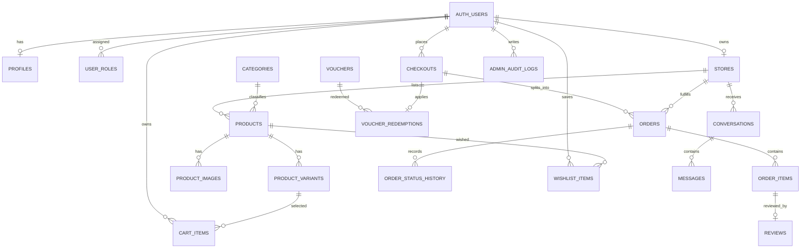

# ERD — SOUQNA (Final M8)

Sumber: `SOUQNA_MVP.md` §8. Skema Drizzle (`db/schema/`) menyusul di fase backend;
mock `frontend/src/mocks/*` ↔ `flutter/lib/mocks/*` sudah memakai nama tabel/kolom yang sama.
Field mock memakai snake_case sama seperti kontrak API agar ganti ke backend nyata tinggal ganti transport.

## Kolom final (acuan `db/schema/*` saat backend dimulai)

| Tabel | PK / Unik | Kolom kunci |
|---|---|---|
| `profiles` | PK `id` (= auth.user) | `full_name`, `phone?`, `avatar_url?`, `default_location?`, `created_at`, `updated_at` |
| `user_roles` | PK (`user_id`, `role`) | `role` = `admin` saja; merchant = punya `stores.owner_id`, bukan role |
| `categories` | PK `id`, unik `slug` | `name`, `description?`, `is_active`, `created_at`, `updated_at` |
| `stores` | PK `id`, unik `owner_id` (1 akun = 1 toko), unik `slug` | `owner_id`, `name`, `description`, `logo_url?`, `pickup_location`, `delivery_available`, `delivery_fee`, `status` (`active`/`inactive`/`suspended`) |
| `products` | PK `id` | `store_id`, `category_id`, `name`, `slug`, `description`, `status` (`draft`/`published`/`hidden`/`suspended`), `created_at`, `updated_at` |
| `product_images` | PK `id` | `product_id`, `storage_path`/`image_url`, `sort_order` |
| `product_variants` | PK `id` | `product_id`, `sku?`, `label`/`options` JSON, `price >= 0`, `stock_quantity >= 0`, `is_active` |
| `cart_items` | PK `id`, unik (`user_id`, `product_variant_id`) | `user_id`, `product_variant_id`, `quantity`, `created_at`, `updated_at` |
| `checkouts` | PK `id`, unik `checkout_code` | `buyer_id` (null saat anonim), `subtotal`, `discount_total`, `grand_total`, `created_at` |
| `orders` | PK `id`, unik (`checkout_id`, `store_id`) | `checkout_id`, `store_id`, `buyer_id` (null saat anonim), `status`, `payment_method` (= `cod`), `payment_status` (`unpaid`/`paid`), `delivery_method` (`pickup`/`merchant_delivery`), `delivery_fee` snapshot, `subtotal`, `discount_amount`, `grand_total`, `buyer_*_snapshot` (anonim saat hapus), `handover_location_snapshot?`, `buyer_note?` |
| `order_items` | PK `id` | `order_id`, `product_id?`, `product_variant_id?`, `product_name_snapshot`, `variant_options_snapshot`, `unit_price_snapshot`, `quantity`, `line_total`; tanpa cascade hapus riwayat |
| `order_status_history` | PK `id` | `order_id`, `from_status`, `to_status`, `changed_by?`, `note?`, `created_at` |
| `vouchers` | PK `id`, unik `code` (uppercase) | `description`, `discount_type` (`percentage`/`fixed_amount`), `discount_value`, `minimum_subtotal`, `maximum_discount?`, `starts_at`, `ends_at`, `usage_limit?`, `used_count`, `is_active`, `created_by` |
| `voucher_redemptions` | PK `id`, unik `checkout_id` (1 voucher/checkout) | `voucher_id`, `checkout_id`, `user_id?`, `discount_amount` |
| `wishlist_items` | PK `id`, unik (`user_id`, `product_id`) | `user_id`, `product_id`, `created_at` |
| `conversations` | PK `id`, unik (`buyer_id`, `store_id`) | `buyer_id`, `store_id`, `created_at`, `updated_at` |
| `messages` | PK `id` | `conversation_id`, `sender_id`, `body` (≤2000), `created_at`; purge `created_at <= now() - 7 hari`, thread tetap ada |
| `reviews` | PK `id`, unik `order_item_id` (1 ulasan/item) | `order_item_id`, `product_id`, `buyer_id`, `rating` 1–5, `review_text?`, `display_name_snapshot?` |
| `admin_audit_logs` | PK `id` | `admin_user_id`, `action`, `target_type`, `target_id`, `metadata` JSON (tanpa secret), `created_at` |

## Catatan implementasi (lihat `docs/data-model.md`)

- `stores.owner_id` unik (1 akun = 1 toko). `cart_items(user_id, variant_id)` unik.
- `orders(checkout_id, store_id)` unik. `voucher_redemptions.checkout_id` unik (1 voucher/checkout).
- `wishlist_items(user_id, product_id)` unik. `reviews.order_item_id` unik (1 ulasan/item).
- Snapshot order (`*_snapshot`) + relasi tanpa cascade agar riwayat selamat dari hapus akun/katalog.
- Uang `numeric(12,2)`, waktu `timestamptz` tampil Asia/Jakarta, stok int ≥ 0.
- Status order: `pending_merchant_confirmation → accepted → ready_for_pickup | out_for_delivery → received_by_buyer → completed` + `rejected`/`cancelled`; `completed` = terima + lunas.
- Parity mock: `frontend/src/mocks/*` ↔ `flutter/lib/mocks/*` — 6 kategori, 4 toko, 20 produk + varian, ID/slug/harga/stok/status sama (cek `scripts/demo-e2e.sh`).

## Masuk backend (setelah M8)

1. Buat `db/schema/*.ts` dari tabel di atas, `drizzle-kit generate`, lalu `db/seed/categories.seed.ts` + `demo.seed.ts` dari mock yang sama.
2. Kontrak endpoint: `docs/openapi.yaml` (stub M8) → lengkapi contoh request/response saat backend ditulis.
3. Jangan mulai backend sebelum checklist M1–M7 hijau (lihat `TODO.md` + `docs/acceptance-roadmap.md`).
