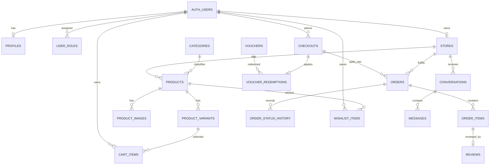

# ERD — SOUQNA

Sumber: `SOUQNA_MVP.md` §8.3. Skema Drizzle (`db/schema/`) menyusul di fase backend;
mock `frontend/src/mocks/*` ↔ `flutter/lib/mocks/*` sudah memakai nama tabel/kolom yang sama.

Catatan implementasi (lihat `docs/data-model.md`):
- `stores.owner_id` unik (1 akun = 1 toko). `cart_items(user_id, variant_id)` unik.
- `orders(checkout_id, store_id)` unik. `voucher_redemptions.checkout_id` unik (1 voucher/checkout).
- `wishlist_items(user_id, product_id)` unik. `reviews.order_item_id` unik (1 ulasan/item).
- Snapshot order (`*_snapshot`) + relasi tanpa cascade agar riwayat selamat dari hapus akun/katalog.
